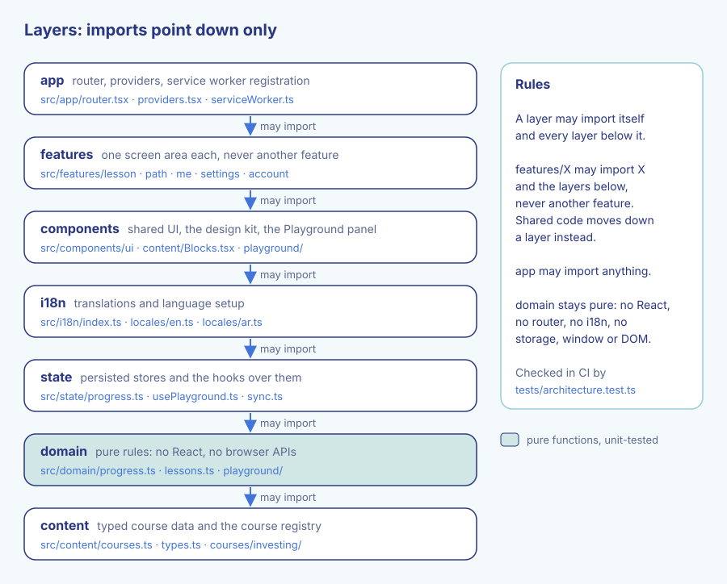
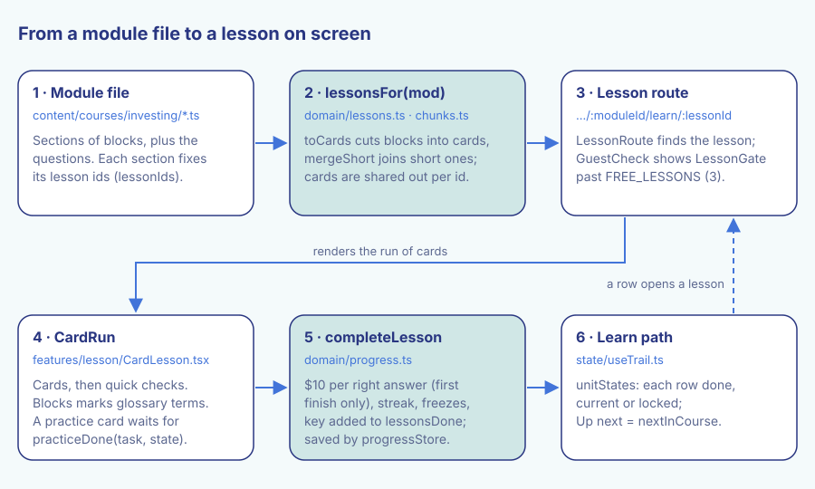
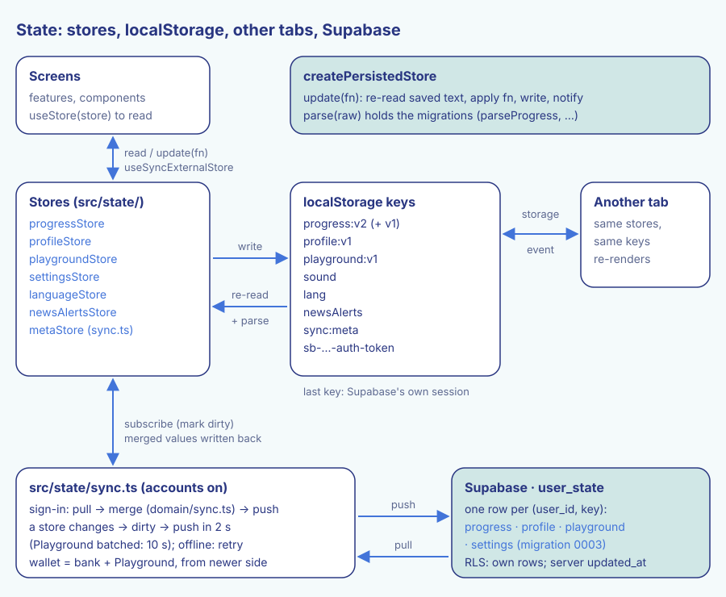
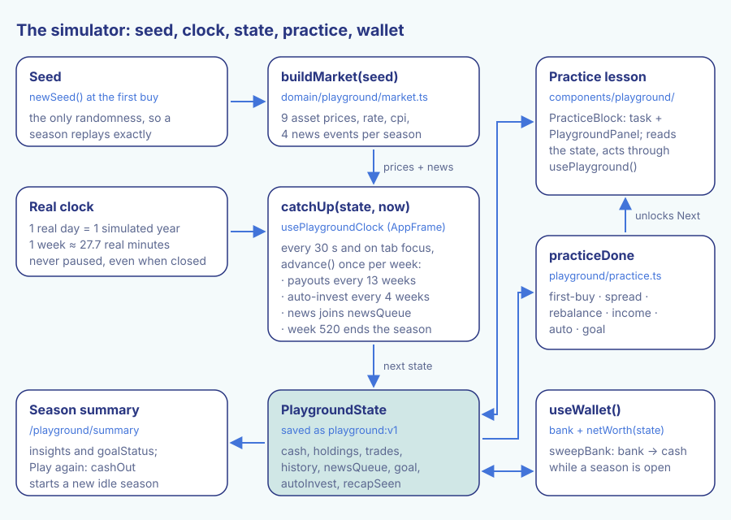

# Architecture

How the Abu Shreek (أبو شريك) app is put together, for a developer joining the project. `CLAUDE.md` holds the
working rules and the product rules; this file explains how the pieces fit. File paths are relative to the repo root.

Contents:

1. [What the app is, and the layers](#1-what-the-app-is-and-the-layers)
2. [From a module file to a lesson on screen](#2-from-a-module-file-to-a-lesson-on-screen)
3. [State and persistence](#3-state-and-persistence)
4. [Accounts and sync](#4-accounts-and-sync)
5. [The simulator](#5-the-simulator)
6. [Offline and install](#6-offline-and-install)
7. [i18n, RTL and design tokens](#7-i18n-rtl-and-design-tokens)
8. [Tests and CI](#8-tests-and-ci)

---

## 1. What the app is, and the layers

Abu Shreek is a study app: an investing course plus a play-money market simulator (the Playground).

- **Stack:** Vite, React 19, TypeScript, React Router 7, TanStack Query (to load course modules), i18next.
- **Guests first:** there is no backend that the app needs. Progress lives in the browser's localStorage.
- **Optional accounts:** with `VITE_SUPABASE_URL` and `VITE_SUPABASE_ANON_KEY` set, learners can sign up and their
  data syncs to Supabase. Without them, the app has no account UI and never downloads Supabase code.
- **Installable and offline:** a production build ships a service worker, so lessons open without a network.
- **Hosting:** GitHub Pages, under the base path `/<repo>/` (see `vite.config.ts`).

The app has two tabs, **Learn** and **Me**. The simulator has no tab of its own: each of the six Investing modules
ends with a hands-on practice lesson that shows the live Playground inside the lesson (see section 5).

### The layers

Code under `src/` is split into layers. Dependencies point one way: down the stack.

*The seven layers. A layer may import itself and the layers below it; features never import each other.*

| Layer | Folder | What lives there | May import |
| --- | --- | --- | --- |
| content | `src/content/` | Course data, the course registry, content hooks | content |
| domain | `src/domain/` | Pure rules: progress, lessons, cards, sync merge, the simulator | domain, content |
| state | `src/state/` | Persisted stores and the hooks over them, auth, sync | state, domain, content |
| i18n | `src/i18n/` | Translations, language setup, number and money formats | i18n, state, domain, content |
| components | `src/components/` | Shared UI (`ui/` is the design kit), content blocks, the Playground panel | components and everything above it in this table |
| features | `src/features/<name>/` | One screen area each (`lesson`, `path`, `me`, `settings`, `account`, …) | itself + components, i18n, state, domain, content |
| app | `src/app/` | Router, providers, service worker registration | anything |

Rules worth remembering:

- **`domain` is pure.** No React, router, i18n or query library, and no `window`, `document`, `navigator` or
  storage. Every rule there is a plain function you can unit-test.
- **A feature never imports another feature.** If two features need the same thing, move it down: logic to
  `domain`, hooks to `state`, UI to `components`. This is why the Playground page body became
  `src/components/playground/PlaygroundPanel.tsx`: the `lesson` feature needs it, and it may not import from a
  `playground` feature.
- **`tests/architecture.test.ts` enforces all of this.** It reads every relative import under `src/`, works out
  each file's layer and fails CI on a wrong-way import. It also fails on a domain file that touches a browser API,
  and on a file in a folder that belongs to no layer.

### Startup

`src/main.tsx` does five things before rendering:

1. `reloadOnStaleChunks()` (`src/app/chunkReload.ts`): reloads once if a deploy removed a code chunk an open tab needs.
2. `registerServiceWorker()` (`src/app/serviceWorker.ts`).
3. `listenForInstall()` (`src/state/install.ts`): keeps the browser's install prompt for Settings.
4. `startSync()` (`src/state/sync.ts`): wires the stores to the account. Does nothing without accounts.
5. `initAuth()` (`src/state/auth.ts`): checks for a saved sign-in.

Then it renders `<Providers>` (the TanStack Query client) around the router from `src/app/router.tsx`.

---

## 2. From a module file to a lesson on screen

*A module file becomes lessons of cards; finishing one updates progress, which moves the Learn path on.*

### Content: courses, modules, sections

- **The registry** is `src/content/courses.ts`. It lists every course, but only those in `ENABLED_COURSE_IDS`
  (today just `investing`) are offered. `getCourse(id)` finds offered courses only, so a hidden course's URL shows
  "not found". `COMING_SOON_IDS` names the few hidden courses the courses page teases.
- **A course** (`src/content/courses/<id>/index.ts`) has `groups` of nav items and one `loaders` entry per module:
  a dynamic `import()`, so each module is its own chunk. A nav item without a loader shows as "Coming soon".
- **A module** (`Module` in `src/content/types.ts`) has `sections` and `questions`. All text is `Localized`
  (`en` + `ar`). Builders such as `L`, `section`, `mcq`, `box` and `practice` live in `src/content/helpers.ts`.
- **A section** has a list of `blocks` (html, box, table, diagram, keyIdea, calculator, exercise, practice, …) and
  fixed `lessonIds`. Every section of an offered course must fix its ids (a test checks this).
- **Questions** have stable ids (`<prefix>-qNNN`). Saved answers point at them, so they are never renumbered.

Modules load on demand through `useModule` / `useModules` (`src/content/useModule.ts`, TanStack Query with
`staleTime: Infinity`).

### Domain: cards and lessons

`lessonsFor(mod)` in `src/domain/lessons.ts` turns a module into roadmap lessons:

1. `toCards(blocks)` (`src/domain/chunks.ts`) cuts a section into cards, one idea each. Html blocks split at
   block tags; a heading or a lead-in ending in ":" sticks to what follows; a `cardBreak` forces a cut.
2. `mergeShort` joins a short card (under 35 words, or a lone key idea) to the one before it, while the pair stays
   within one screen of reading (90 words). Cards with media (table, diagram, calculator, code, tabs, practice)
   never merge.
3. The cards are shared out evenly between the section's `lessonIds`. Exercise blocks become question steps in the
   part where they appeared.

Because the ids are fixed per section, editing text never moves a learner's ✓. To split a long section, add an id;
the old id keeps its ✓. `tests/lesson-ids.test.ts` snapshots every lesson id, so a change that would reset ✓ marks
shows up in review.

### Routes and screens

Routes live in `src/app/router.tsx`. Every route except the shells and Learn is lazy-loaded.

| Path | Screen |
| --- | --- |
| `/` | Learn (`src/features/path/PathPage.tsx`), inside `TabsLayout` with the tab bar |
| `/me` | Me, inside `TabsLayout` |
| `/course/:courseId/:moduleId/learn/:lessonId` | A roadmap lesson (`LessonRoute` in `src/features/lesson/CardLesson.tsx`) |
| `/course/:courseId/review` | Daily review of questions last answered wrong |
| `/course/:courseId/:moduleId/lesson` | Quiz-only unit review |
| `/playground` | Redirects to the basics module's practice lesson (`practice-first-buy`) |
| `/playground/summary` | The season summary |
| `/welcome`, `/welcome/:step` | Onboarding |
| `/settings`, `/courses`, `/certificate/:courseId/:moduleId`, `/legal/:page` | Other mobile screens |
| `/signup`, `/login`, `/account`, … | Account screens, behind `AccountGate` |
| `/course/:id` | The desktop course page, in `AppShell` |

`AppFrame` (`src/components/AppFrame.tsx`) wraps the mobile screens. It sends first-time visitors to `/welcome`
(account and legal pages excepted), and it runs the Playground clock for the whole app (section 5).

### Inside a lesson

`LessonRoute` loads the module, runs `lessonsFor`, finds the lesson and renders `CardRun`:

- **Cards** render through `Blocks` (`src/components/content/Blocks.tsx`). All content HTML goes through
  `safeHtml()` (DOMPurify).
- **Glossary terms** are marked as cards render: `markTerms` (`src/domain/glossary.ts`) wraps the first
  appearance of each term from `src/content/glossary.ts` in `<dfn data-term>`, never inside links, code or headings.
  A tap or Enter opens `GlossarySheet`.
- **Questions** come after the cards. The first try counts for the score and the review boxes; a wrong first try
  can be tried again.
- **Practice cards** (`{ type: 'practice', task }`) render `PracticeBlock`: a task banner plus the live
  `PlaygroundPanel`. The lesson's Next button waits until `practiceDone(task, state)` is true. A lesson that was
  already finished never blocks.
- **On the last step**, `completeLesson` (`src/domain/progress.ts`, called through `useProgress`) runs:
  - adds $10 per right answer to the bank, but only on the first finish of that lesson (replays pay nothing);
  - updates the streak (spending streak freezes for missed days) and earns a freeze for a perfect first finish;
  - adds the key `course/module/lessonId` to `lessonsDone` and sets `lastLesson`;
  - adds the day's earnings to `activity`.

### Back on Learn

`useTrail(courseId)` (`src/state/useTrail.ts`) loads the course's modules, runs `lessonsFor` on each, and asks
`unitStates` (`src/domain/pathStates.ts`) for each row's state: `done`, `current` (the first unfinished) or
`locked`. Modules don't lock each other. `nextInCourse` (`src/domain/lessons.ts`) picks the Up next lesson.

### The guest limit

When accounts exist and nobody is signed in, `useGuestLimited()` (`src/state/useAccess.ts`) is true. Then:

- guests get the first `FREE_LESSONS` (3) lessons in path order (`canOpenLesson` in `src/domain/access.ts`);
- later rows on Learn read "Sign up to unlock", and the Up next card becomes a sign-up card;
- a locked lesson or unit review opened by URL shows `LessonGate`;
- lessons already finished stay open.

Without Supabase, everything is open.

---

## 3. State and persistence

*Stores own their localStorage key, other tabs follow through the storage event, and sync.ts mirrors four of them to Supabase.*

### One store factory

Every value kept in localStorage goes through `createPersistedStore` (`src/state/createPersistedStore.ts`).
A store has `get`, `update(fn)`, `reset` and `subscribe`.

- **`update(fn)` re-reads storage first.** It applies `fn` to the latest saved value, not to a stale cache. Two
  open tabs therefore never overwrite each other's progress.
- **Other tabs follow.** A `storage` event for the store's key refreshes the cache and notifies subscribers.
- **`parse` is where migrations live.** It must accept old shapes and garbage. To change a format, bump the key
  suffix and list the old key in `legacyKeys`; the old value is parsed the first time the new key is empty.
- **Storage can fail.** If localStorage is blocked or full, values live in memory for that page view.

Components read a store with `useStore(store)` (`src/state/useStore.ts`, built on `useSyncExternalStore`).
Don't write new `localStorage` code; add a store instead.

### The stores

| Store | File | localStorage key | Holds |
| --- | --- | --- | --- |
| `progressStore` | `src/state/progress.ts` | `progress:v2` (imports `progress:v1`) | Answers, bank, streak, freezes, review boxes, `lessonsDone`, `activity`, `perfect` |
| `profileStore` | `src/state/profile.ts` | `profile:v1` | Onboarding choices, daily goal, active course |
| `playgroundStore` | `src/state/playground.ts` | `playground:v1` | The simulator season (section 5) |
| `settingsStore` | `src/state/settings.ts` | `sound` | Sound on or off |
| `languageStore` | `src/state/language.ts` | `lang` | `en` or `ar` |
| `newsAlertsStore` | `src/state/newsAlerts.ts` | `newsAlerts` | Market news alerts on or off |
| `metaStore` | `src/state/sync.ts` | `sync:meta` | Sync bookkeeping: whose data this is, when each store changed |

Two exceptions write storage directly: Supabase keeps its session under `sb-…-auth-token`, and
`src/app/chunkReload.ts` keeps a reload guard in sessionStorage.

### Migrations

- **`parseProgress`** (`src/domain/progress.ts`): v1 counted XP. A v1 player gets the $1,000 starting bank plus
  $10 for every question they answered right.
- **`parsePlayground`** (`src/domain/playground/persist.ts`): seasons saved before time followed the real clock
  (with `speed` or `pendingEvent`) carry on from the week they were at. Old seasons also get a `deposits` log and a
  `recapSeen` count.

Rules live in `src/domain/`; the stores only hold values. Screens change progress through `useProgress`
(`src/state/useProgress.ts`) and the Playground through `usePlayground` (`src/state/usePlayground.ts`).

---

## 4. Accounts and sync

Accounts are optional and use Supabase (`docs/SUPABASE-INTEGRATION.md`). Guest mode stays complete.

### Client and auth

- `src/state/supabase.ts` decides `accountsEnabled` from the two env vars. `loadSupabase()` downloads the client on
  first use, so guests never pay for it.
- `src/state/auth.ts` holds `authStore` (`off`, `loading`, `signedOut`, `signedIn`, `recovery`). Without a saved
  session or an email link, the client isn't even loaded at startup. Screens call only its functions: `signIn`,
  `signUp`, `requestPasswordReset`, `updateName`, `updateEmail`, `setNewPassword`, `signOut`, `deleteAccount`.
- Form rules live in `src/domain/auth.ts`. There is no email confirmation step.
- Only the project URL and the anon key ever reach the frontend. Never a `service_role` key.

### The `user_state` table

One row per learner per key. `data` is the store's JSON, exactly as kept in localStorage.

| key | Comes from |
| --- | --- |
| `progress` | `progressStore` |
| `profile` | `profileStore` |
| `playground` | `playgroundStore` |
| `settings` | sound + language (`prefsStore` in `sync.ts`); needs migration 0003 |

Migrations in `supabase/migrations/`:

- `0001_user_state.sql`: the table, row-level security (a learner reads and writes only their own rows), a trigger
  that sets `updated_at` from the server clock, and `delete_my_account()`.
- `0002_remove_ba2_tables.sql`: drops the old BA2 app's tables. Read its header before running it.
- `0003_user_state_settings.sql`: allows the `settings` key.

### Pull, merge, push

`src/state/sync.ts` does the plumbing; `src/domain/sync.ts` holds the pure merge rules. The local stores stay the
source the screens read, so the app is instant and works offline.

1. **Sign-in: pull.** Read all four rows. If this device last belonged to another account (`signInPlan` returns
   `replace`), start from empty local data so nothing leaks between accounts. Otherwise merge.
2. **Merge.**
   - Learning is additive: `mergeProgress` keeps the union of finished lessons, sections read and answers (a right
     answer beats a wrong one), the higher review box, the larger day's earnings, and the newer streak.
   - **The wallet is not additive.** The bank and the Playground are two halves of one wallet, so both come whole
     from one side: the one saved more recently (`walletSide`). Adding or taking the max would create or destroy
     play money.
   - The profile and preferences come from the newer side; "finished onboarding" sticks.
3. **Push.** Upsert whatever differs from the server. Progress, profile and Playground go in one request, so the
   bank and the Playground always arrive together. Settings go on their own, so a project without migration 0003
   can't block the rest.

After that, a store change marks it dirty and pushes after 2 seconds (Playground changes are batched: 10 seconds).
Failures retry after 30 seconds and when the browser comes back online. Leaving the tab pushes; returning after a
minute pulls. Signing out stops sync; the device keeps its data as guest progress.

---

## 5. The simulator

*A seed fixes the market, the real clock moves the season week by week, and practice lessons read and change the state.*

All rules are pure functions in `src/domain/playground/`. Every number is in `config.ts`.

### Seed to market

- A season's **seed** is picked at the first buy (`newSeed` in `src/state/usePlayground.ts`). It is the only
  randomness.
- `buildMarket(seed)` (`market.ts`) derives the whole season at once: weekly prices for nine assets, the interest
  rate, inflation, a price index (`cpi`), and four news events. It uses a counter-based generator (`prng.ts`), so
  the same seed always gives the same market. Results are memoised.
- **Trades never move prices.** A season replays exactly.
- The nine assets have generic names only (Safe Savings … Crypto Coin (fictional)). Newer assets follow the
  world-stocks weekly move through `beta`.

### Real clock to state

- **1 real day = 1 simulated year.** One tick is one week (about 27.7 real minutes). A season is 10 years, so
  520 weeks. There are no play, pause or speed controls.
- The first buy starts the season and records `startedAt`.
- `usePlaygroundClock` runs in `AppFrame`, so it is live on every screen. On start, every 30 seconds and when the
  tab comes back into view, it calls `catchUp(state, Date.now())`.
- `catchUp` calls `advance()` once per week missed, even if the app was closed for days. Each week, `advance`:
  - pays dividends, rent and bond interest every 13 weeks (into cash, or bought back without a fee when `reinvest`
    is on, the default);
  - runs auto-invest every 4 weeks (a month that cash can't cover is skipped);
  - adds that week's news to `newsQueue` (time never waits for it; stories open one at a time);
  - appends net worth to `history`, and ends the season at week 520.

### Other pieces

| Piece | Where | What it does |
| --- | --- | --- |
| Fees | `engine.ts` | 1% on every buy and sell |
| Compare line | `benchmark()` in `engine.ts` | Replays the `deposits` log all in one asset |
| Allocation ring | `allocation()` in `risk.ts` | Shares of net worth, cash included |
| Rebalance | `rebalance.ts` | Sells what is over, buys what is under, toward an example mix in `MIXES` |
| Yearly recap | `recap.ts` | After each finished year, once (`pendingRecap`, `recapSeen`) |
| Season goal | `goalStatus` in `insights.ts` | Beat inflation, never fall more than 15%, or earn $50 in payouts |
| Season summary | `insights.ts`, `/playground/summary` | Derived from the trades, never advice |

### Practice lessons

Each Investing module ends with a practice lesson. Its ids:

| Lesson id | Task | `practiceDone` is true when |
| --- | --- | --- |
| `practice-first-buy` | `first-buy` | The season has started (first buy made) |
| `practice-spread` | `spread` | Three or more assets are held |
| `practice-rebalance` | `rebalance` | Holdings are within 5 points of an example mix |
| `practice-income` | `income` | Something that pays out is held |
| `practice-auto` | `auto` | Auto-invest is set |
| `practice-goal` | `goal` | A season goal is set |

- A practice lesson is a section holding a `{ type: 'practice', task }` block (`src/content/types.ts`, helper
  `practice()` in `src/content/helpers.ts`).
- `PracticeBlock` shows the task banner and `PlaygroundPanel` (`src/components/playground/`): net worth, chart,
  allocation ring, holdings, the Buy/Sell sheet, goal and auto-invest cards, news and recap overlays.
- The panel acts only through `usePlayground()` (buy, sell, rebalance, setAutoInvest, setReinvest, setGoal,
  readNews, seeRecap). Every action is a pure engine function written back to `playgroundStore`.
- `practiceDone(task, state)` (`src/domain/playground/practice.ts`) reads only the Playground state, so the lesson
  and the tests agree. Next waits for it; a lesson already finished never waits, so replaying a practice lesson is
  how players visit their portfolio. On that step, Enter belongs to the simulator's buttons.
- `src/features/playground/` now holds only the season summary route.

### One wallet

- `useWallet()` = the bank (`progress.bank`) + the Playground's net worth. Learn, Me and Lesson complete show it.
- **Sweep:** while a season is open, `usePlayground` moves the bank into the Playground's cash (`fund`). Lesson
  rewards earned mid-season join the cash and count as money moved in. The Playground is credited first, so a crash
  between the two saves can only leave extra play money.
- **Cash out:** money leaves only between seasons (`canWithdraw`). "Play again" on the summary calls `cashOut`:
  the net worth goes back to the bank, and a new idle season starts. Auto-invest, reinvest and the goal carry over.

---

## 6. Offline and install

### The service worker

`scripts/serviceWorker.ts` is a Vite plugin (build only). It writes `sw.js` into the build:

- **Precache:** the whole built app (HTML, scripts, styles, fonts) plus everything in `public/` (diagrams, icons),
  except `public/guides/`.
- **Runtime cache:** the guide pictures are cached on first use (all of them are too heavy to fetch up front).
- **Cache name:** `abu-shreek-<hash of the file list>`. A new deploy gets a new cache; old ones are deleted on
  activate.
- **Pages** are network-first, falling back to the cached `index.html` offline.
- **Files** are cache-first; new same-origin files are added to the cache.
- Only same-origin GETs are handled. Supabase calls go untouched.

`src/app/serviceWorker.ts` registers it in production builds only, at `${BASE_URL}sw.js`.

### Install

`src/state/install.ts` catches `beforeinstallprompt`, so Settings can show "Install the app" when the browser
offers it. iOS has no such event, so the row doesn't show there.

### Market news alerts

`src/state/newsAlerts.ts`, a switch in Settings, off by default. When `usePlaygroundClock` sees news land, it
raises a notification, through the service worker when there is one (phones require that). Tapping it opens
`./playground`, which now redirects to the first practice lesson. There is no backend, so alerts only come while the
app is open (a background tab is enough). Stories that landed while it was closed wait in the queue instead.

---

## 7. i18n, RTL and design tokens

- **Two languages, one at a time.** UI strings live in `src/i18n/locales/en.ts` and `ar.ts`; keys are type-checked
  against `en`. Content text is `Localized` data. Never render the other language next to the current one.
- **RTL.** `src/i18n/index.ts` sets `<html lang dir>` on every language change and keeps `languageStore` in step,
  so another tab switches too. CSS uses logical properties. Money is always left-to-right with Western digits
  (`<Money>`, `formatMoney`, `moneyText`).
- **Tokens.** Every colour, radius, font and type size lives in `src/styles/tokens.css`. Components use token names
  only. Title sizes come from the type tokens (`--title-page`, `--title-section`, `--title-small`,
  `--title-switcher`, `--display`); lesson card text uses `--lesson-text`, `--lesson-small` and `--lesson-label`. Fonts are self-hosted (`src/styles/fonts.css`): Instrument Sans for English, IBM Plex Sans
  Arabic for Arabic.
- **Flat look.** No gradients, glows, blur or shadows except the focus ring on text inputs. Shared controls
  (`Button`, `Card`, `AnswerOption`, `TabBar`, …) are in `src/components/ui/`.

---

## 8. Tests and CI

### Unit tests (`npm test`, Vitest, `tests/`)

Most tests call domain functions directly: `progress`, `lessons`, `chunks`, `playground`, `sync`, `access`,
`glossary`, `persisted-store`, and so on. Some tests guard the conventions:

| Test | Guards |
| --- | --- |
| `architecture.test.ts` | Layer boundaries; pure domain |
| `content.test.ts` | Content shape; no scripts, iframes or handlers in content HTML |
| `lesson-ids.test.ts` | Snapshot of every lesson id (`tests/__snapshots__`) |
| `lesson-cards.test.ts` | Card lengths and one lesson typography |
| `i18n.test.ts`, `arabic-plurals.test.ts` | Same keys, `{{vars}}` and plural forms in EN and AR |
| `design-tokens.test.ts` | No raw colours outside `tokens.css` |
| `flat-ui.test.ts` | No gradients, blur, glows or shadows |

Update the lesson-id snapshot (`npx vitest -u`) only when you accept resetting learners' ✓ marks.

### End-to-end tests (`npm run test:e2e`, Playwright, `e2e/`)

- `playwright.config.ts` builds the app and serves it with `vite preview` under `/Courses/`, the same base path as
  GitHub Pages. A hard-coded `/` or a broken asset path fails here.
- The build has accounts switched on with a made-up project. `e2e/fakeSupabase.ts` answers every request to it, so
  sign-up, sign-in and sync are tested without a real database.
- Specs cover onboarding, a lesson by keyboard, RTL, deep links, one language per screen, no sideways scroll at
  320px, axe accessibility checks, the guest limit, accounts, practice lessons, the simulator and offline use.
- The viewport is 390×844, the design's phone size.

### Bundle budget (`npm run check:bundle`)

`scripts/check-bundle.mjs` gzips every script linked from `dist/index.html` and fails above 175 KB. Raise the budget
on purpose, in the change that adds the weight.

### GitHub workflows

| Workflow | When | Steps |
| --- | --- | --- |
| `.github/workflows/ci.yml` | Pull requests, pushes to branches other than `master` | Job `check`: lint, unit tests, build with `GITHUB_PAGES=true`, bundle budget. Job `e2e`: Playwright (traces uploaded on failure) |
| `.github/workflows/deploy.yml` | Pushes to `master`, manual | Lint, unit tests, build with the Supabase secrets, copy `index.html` to `404.html` (Pages has no rewrites), deploy to GitHub Pages |
